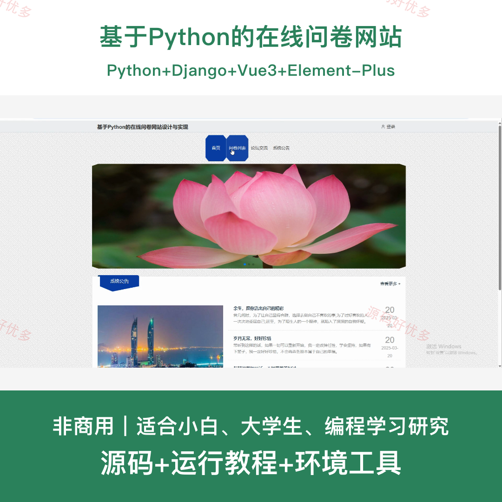
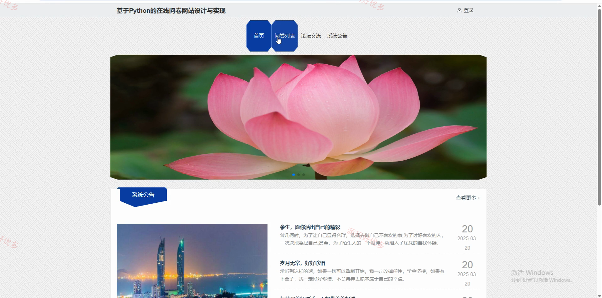
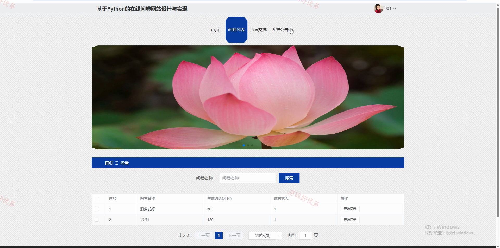
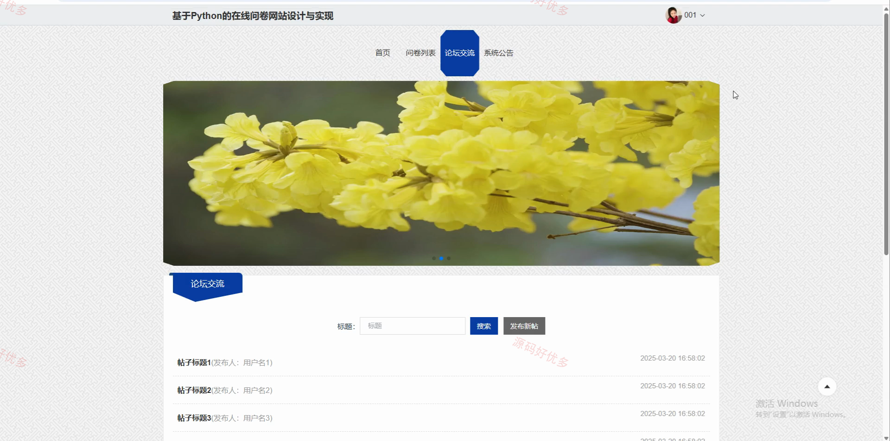
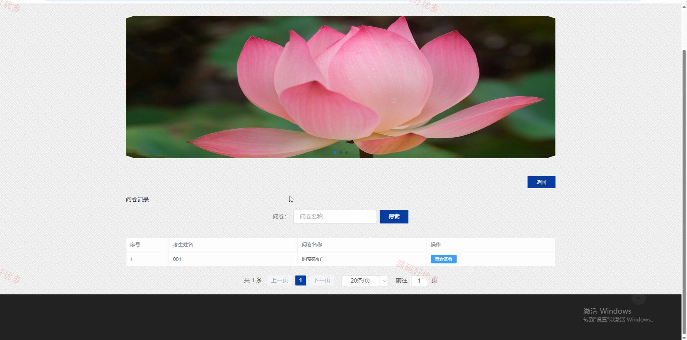
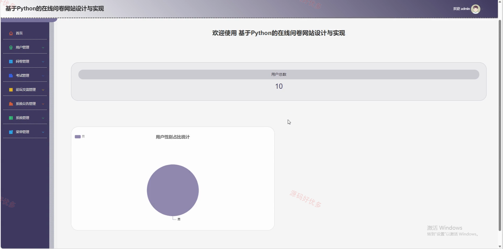
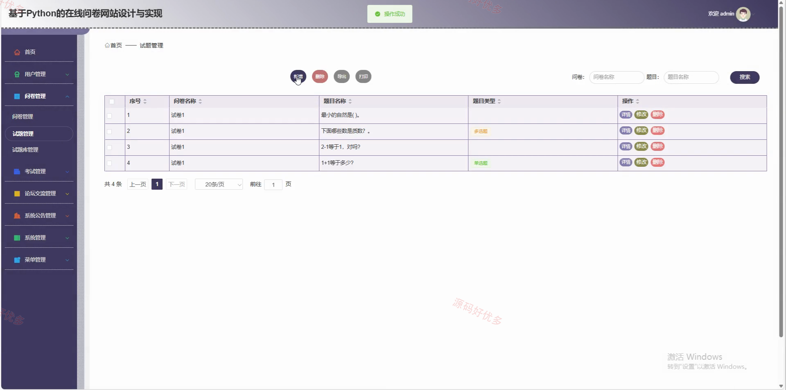
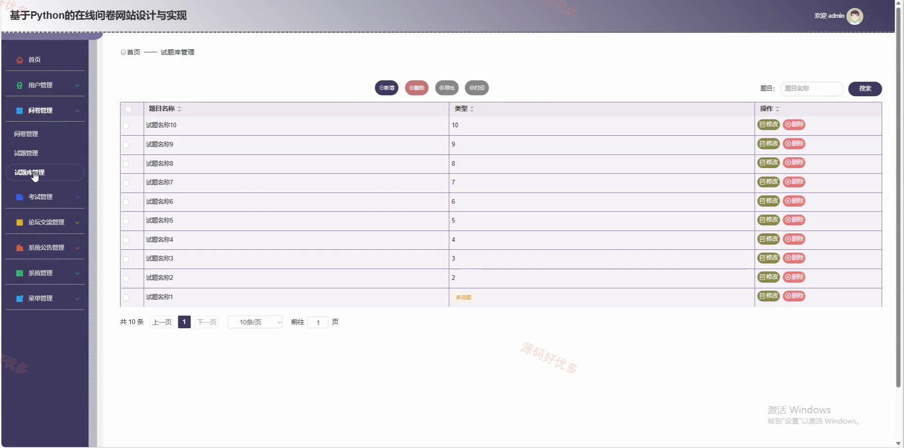

# python158D
python158D基于Python的在线问卷网站 源码 系统 Python Django
## 源码问题查看主页咨询

### 一、关键词
在线问卷、问卷调查、调查表单、意见征集、问卷统计

### 二、作品包含
源码+数据库+全套环境和工具资源+本地部署教程

### 三、项目技术
前端技术： Html、Css、Js、Vue3.2、Element-Plus
后端技术：Python、Django

### 四、运行环境（以下版本亲测，其他版本兼容性请自行测试）
开发工具：PyCharm + VSCODE

数据库：MySQL5.7+（共13张表）

数据库管理工具：Navicat10以上版本

环境配置软件： Python3+

前端Nodejs：16+

浏览器：谷歌浏览器

### 五、项目介绍
项目编号：python158D

基于Python的在线问卷网站面向在线问卷浏览、记录查询与互动交流场景，用户可查看问卷及问卷记录、参与论坛交流与评价、查阅系统公告并维护个人发布；管理员可统一维护用户、问卷、考试、论坛、公告和系统配置。

角色：管理员、用户

管理员功能：后台登录、用户管理、问卷管理、考试管理、论坛交流管理、系统公告管理、系统管理、菜单管理。

用户功能：前台登录与注册、问卷列表查看、问卷记录查看、论坛交流及评价、系统公告查看、我的发布及评价、个人中心维护。

### 六、运行截图

